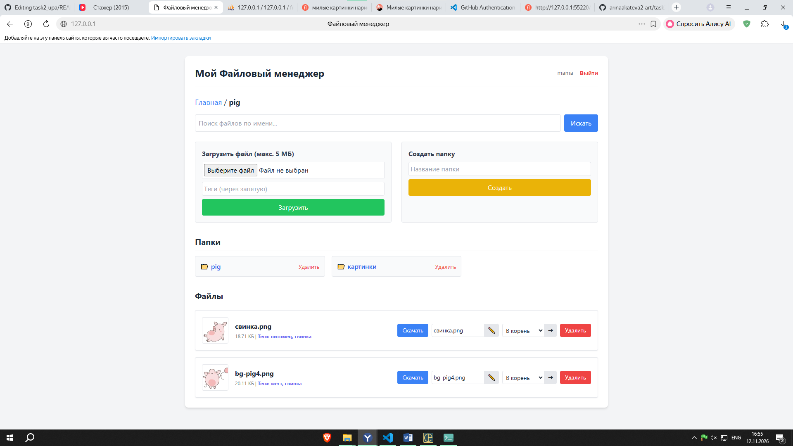
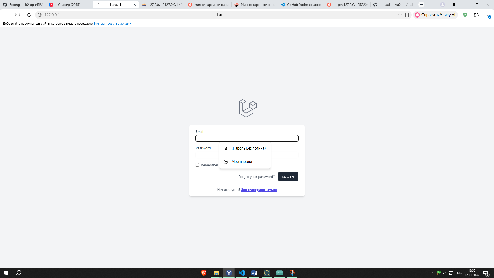
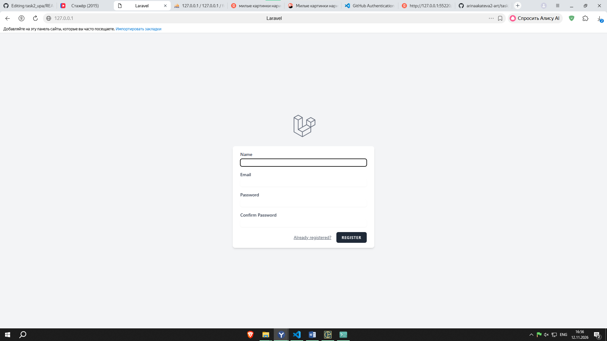

# Простой Файловый Менеджер на Laravel

Это веб-приложение, созданное в рамках учебного задания. Оно позволяет удобно хранить, искать и систематизировать файлы.

## Что умеет приложение:
- Регистрация и вход пользователей (у каждого свои файлы).
- Загрузка файлов (до 5 МБ, форматы: JPG, PNG, PDF).
- Создание и удаление папок.
- Скачивание, переименование и удаление файлов.
- Поиск файлов по названию.
- Добавление тегов к файлам.
- Перенос файлов между папками.
- Предпросмотр картинок (миниатюры).

## Технологии:
- PHP 8.1
- Laravel 10
- MySQL (или SQLite)
- Tailwind CSS

## Как запустить проект:

1. Скачайте проект:
git clone https://github.com/arinaakateva2-art/task2_upa.git
cd task2_upa

2. Установите зависимости:
composer install

3. Создайте файл настроек:
cp .env.example .env

4. Сгенерируйте ключ:
php artisan key:generate

5. Настройте базу данных в файле .env (или пропишите DB_CONNECTION=sqlite для простой базы).

6. Создайте таблицы и ссылку для файлов:
php artisan migrate
php artisan storage:link

7. Запустите сервер:
php artisan serve

8. Откройте в браузере http://127.0.0.1:8000, зарегистрируйтесь и пользуйтесь!

## Скриншоты:

Главная страница (файлы и теги):

Работа с папками:

Авторизация:

Регистрация:

